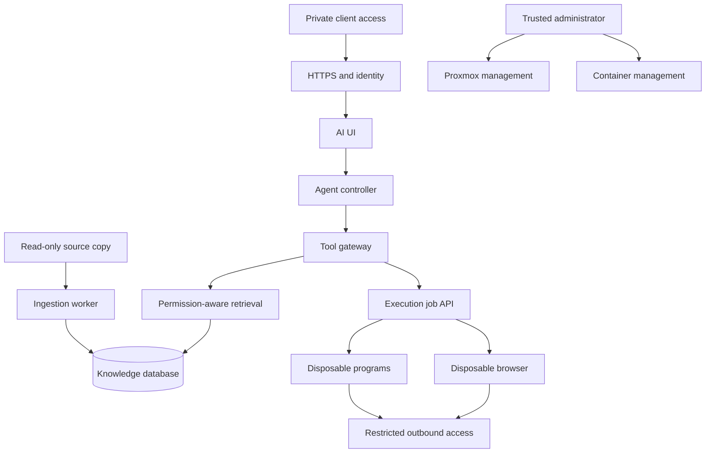

# Proposed Proxmox architecture

Status: design only. Current Proxmox version, hardware, storage health and networking were not inspected. Do not infer readiness from previous home-lab work.

## Placement

Proxmox manages VMs, disks, virtual networking, snapshots and VM backups. Docker/Compose inside Linux guests manages application containers. Dockge, Portainer or Komodo can provide application administration; they are not agent tools. Proxmox's [official FAQ](https://github.com/proxmox/pve-docs/blob/master/pve-faq.adoc) recommends a QEMU VM for application-container orchestration/live-migration use cases.

| Zone | Proposed placement | Contains | Permissions |
|---|---|---|---|
| Administrator | Existing management environment or dedicated management VM | Deployment configuration, container manager, backup controls | Trusted operator only; no model-facing endpoints |
| Knowledge | Linux VM `knowledge` | Retrieval API, PostgreSQL/pgvector, source copies, document metadata | Internal API access; source read-only to ingestion |
| AI control | Linux VM or separate services on knowledge VM initially | UI, agent controller, gateway, workflow state | May invoke approved tools; cannot administer infrastructure |
| Execution | Separate Linux VM `execution` | Job controller, disposable browser/program/document workers | No persistent database admin credentials or management subnet route |
| Inference | Suitable existing host or dedicated VM | Local model/embedding endpoints | Narrow authenticated API; hardware access only where required |
| Recovery | Off-host destination; evaluate Proxmox Backup Server | VM backups and independent application backups | Separate credentials and retention |

These are roles, not mandatory immediate VM count. A small host can begin with two guests: persistent services and disposable execution. Keep VM memory within actual available capacity, leaving host overhead. Storage on the same physical machine is not off-host recovery or hardware-failure resilience.

## Networks and identities

Give each service group its own Compose project and explicit networks. A Compose bridge is not a policy engine. Put authorization in the tool service, deny unwanted VM-to-VM routes, and enforce outbound policy so workers cannot bypass the proxy through direct IPv4, IPv6, DNS or UDP traffic. Inspect Docker's interaction with the chosen firewall backend and test from outside the guest.

Block worker access to Proxmox administration, SSH administration, Docker APIs, private LANs, link-local/cloud metadata addresses and database ports except for narrow required endpoints. For internet tools, validate URL schemes, every redirect, resolved addresses and response sizes. Account for DNS rebinding and browser subrequests. A hostname allowlist does not stop exfiltration to an allowed destination; use narrowly scoped accounts and avoid giving the browser private knowledge unnecessarily.

Use a different identity per service and project. Secrets belong to tool services or a credential broker; they must not be available through generic file, shell or notebook tools. Compose file-mounted secrets reduce accidental environment exposure but do not encrypt the source file or protect against administrators. [Compose secrets](https://docs.docker.com/compose/how-tos/use-secrets/).

## Files and jobs

| Path inside a worker | Access | Lifetime |
|---|---|---|
| `/sources/<collection>` | Read-only selected data, preferably available only through retrieval | Source-copy lifecycle |
| `/workspace/<project>` | Explicit project read/write | Project lifecycle |
| `/inputs` | Read-only job inputs | Job lifecycle |
| `/outputs` | Job outputs; promote after validation | Persistent once accepted |
| `/scratch` | Bounded temporary storage | Removed after job |
| Secret store and host paths | No general file access | Not mounted |

The file service must constrain canonical paths, symlinks and races, not merely reject `../` strings. Tool schemas should distinguish input/output/project IDs from arbitrary host paths. Use non-root users, dropped capabilities, no-new-privileges, read-only roots where compatible, temporary writable directories, PID/time/CPU/memory/storage limits and bounded output. Do not solve failures with privileged mode.

Run authenticated browser profiles separately from anonymous research. Assign browser sessions per user/project, protect debugging and viewer endpoints, and treat cookies as credentials. Stage downloads before processing; malware scans supplement parser isolation and cannot prove safety. Avoid keeping powerful browser sessions alongside unrestricted shell access unless the shared compromise boundary is accepted deliberately.

## Selecting isolation

| Option | Boundary | Where to evaluate |
|---|---|---|
| Ordinary OCI container | Namespaces/cgroups and host kernel | Trusted small services and controlled jobs |
| Rootless Docker/Podman | Reduces daemon/runtime privilege | Supported workloads after networking/device checks |
| gVisor | Additional userspace kernel boundary | Execution VM after syscall/browser compatibility tests |
| OpenShell | Enforced filesystem/network/process policy | Agent runtime when host prerequisites and policy behavior pass tests |
| Kata / Firecracker / Docker Sandboxes | Separate guest kernel / microVM design | Stronger execution isolation after KVM and nested-virtualization validation |
| Dedicated Proxmox VM | Guest kernel separate from the hypervisor host | Main separation between persistent services and execution |

These mechanisms have different responsibilities and are not interchangeable. Docker Sandboxes currently documents Ubuntu 24.04+, KVM for local Linux execution and nested virtualization when used inside a VM. It is a runtime product, not a Compose sidecar. [Installation](https://docs.docker.com/ai/sandboxes/install/), [isolation](https://docs.docker.com/ai/sandboxes/security/isolation/). GPU passthrough, suspend and live migration have additional hardware/storage constraints; do not promise all of them together.

## Recovery and administration

Maintain application-consistent PostgreSQL backups, original files, configuration, secrets and encryption keys. Coordinate database metadata with uploaded objects. VM snapshots alone do not demonstrate recoverability. An execution job must be disposable without losing accepted outputs or knowledge data.

Use a trusted deployment workflow with approved image templates. If a job launcher needs Docker privileges, place it only on the execution VM, validate inputs against fixed templates and keep it unreachable through arbitrary agent command execution. A read-only Docker socket mount still exposes powerful API operations; it is not an authorization control. Test disaster recovery on another guest or host and record actual recovery time and data loss.
